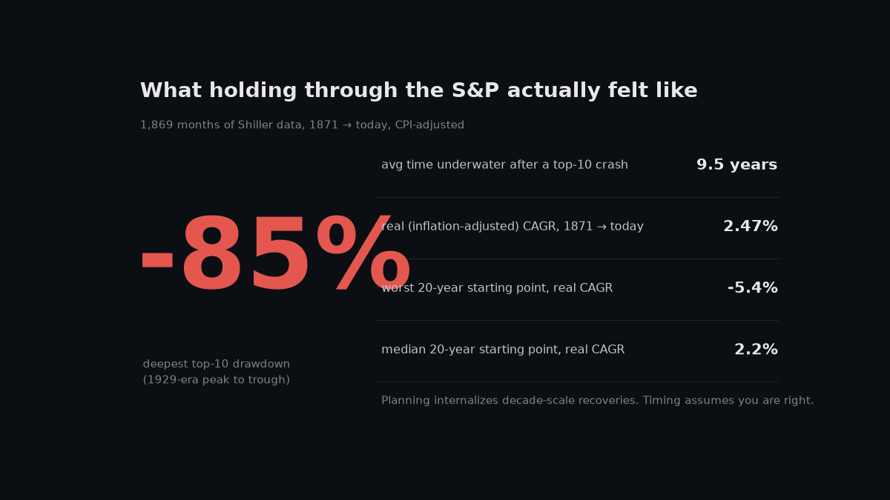
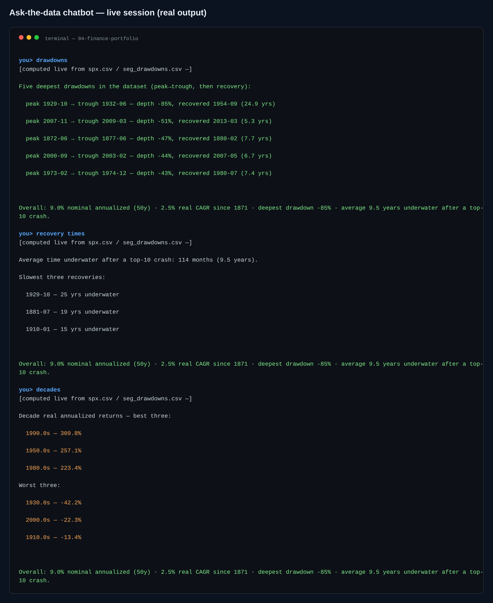

# 150 years of "just hold": drawdowns, patience, and honest CAGR



The dataset is a public GitHub mirror derived from R. Shiller's monthly S&P 500
series — 1,869 months, 1871 → present, with CPI so the returns can be stated in
real terms. The question I kept asking it: *what does a client actually sit
through if they "just hold"?*


Unfortunately-edifying answers:

- **The deepest top-10 drawdown ran ≈ -85%** (1929-era). The *average* month
  underwater after a top-10 crash is **9.5 years** — decade-scale recoveries are the
  norm, not the exception.
- **Real CAGR since 1871 is 2.47%,** not the compounding figure you see on
  posters (the nominal number is real marketing; the CPI-adjusted one is real life).
- **Forward-20Y real returns depend brutally on the starting month:** from **-5.4%**
  (worst entry) to **+6.4%** (p90), median +2.2%. Horizon discipline beats timing —
  but starting matters too.
- Committee stress-test anchors: best calendar year **+46.2%**, worst **-45.6%**.
- The "patience curve" (forward 20Y real CAGR at every entry month, CPI starts
  1913) is the chart I'd put in front of a nervous client.

## Where it's built

`01_analysis.py` does peak-trough-recovery episode detection over the full series
(not just monthly changes), the real/nominal split, decade returns and the
patience curve. `02_ai_market_brief.py` writes the CFO brief from verified stats
only; `03_dashboard.py` builds the log-scale history + drawdown leaderboard +
patience view as one HTML file; `05_banner.py` is the image above; `06_chat.py`
talks through any of it.

## Run it

```bash
python3 -m venv .venv && .venv/bin/pip install -r requirements.txt
.venv/bin/python src/00_download_data.py     # or use data/raw as shipped
.venv/bin/python src/01_analysis.py          # kpis.json regenerates here
.venv/bin/python src/03_dashboard.py

.venv/bin/python src/06_chat.py "drawdowns"    # 1929 peak took ~24.9y to recover
.venv/bin/python src/06_chat.py                # REPL — real/nominal, decades, PE10
```

Verified answers on request: deepest drawdowns + recovery times, real vs nominal,
decade returns, best/worst years, Shiller PE10. LLM narration (`GROQ_API_KEY`)
stays inside the verified numbers; absent it, a deterministic engine gives the
same answers.



## Not investment advice, and why

Monthly series understates intramonth drawdowns; the index isn't a tradable
portfolio (no taxes/costs/dividends assumptions at the tick level); recent rows
fill CPI with 0 and are treated as missing (documented in code). Read the numbers,
then talk to a fiduciary.
